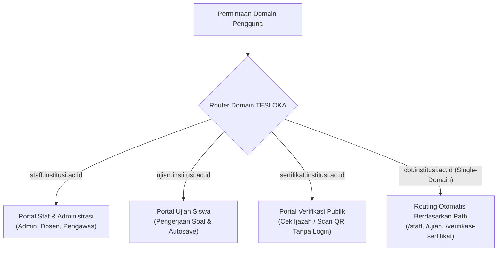

<p align="center">
  
</p>

<h1 align="center">TESLOKA CBT</h1>

<p align="center">
  <strong>Platform Sistem Evaluasi Computer-Based Test (CBT) Terstandar Institusi Pendidikan.</strong><br>
  Satu instalasi independen untuk satu institusi — 100% on-premise single-tenant dengan kedaulatan data penuh.
</p>

<p align="center">
  <a href="https://github.com/mdodeep/Tesloka"></a>
  
  
  
  
  
  
  
</p>

---

## Daftar Isi
- [Apa Itu TESLOKA?](#apa-itu-tesloka)
- [Arsitektur Domain & Tiga Portal](#arsitektur-domain--tiga-portal)
- [Fitur Utama](#fitur-utama)
- [Matriks Sizing & Spesifikasi Server](#matriks-sizing--spesifikasi-server)
- [Panduan Instalasi Lokal (Development)](#panduan-instalasi-lokal-development)
- [Panduan Deployment Produksi (VPS / aaPanel / Linux)](#panduan-deployment-produksi-vps--aapanel--linux)
- [Akun Demo & Kredensial Default](#akun-demo--kredensial-default)
- [Panduan Pemecahan Masalah (Troubleshooting)](#panduan-pemecahan-masalah-troubleshooting)
- [Perintah Artisan Bawaan](#perintah-artisan-bawaan)
- [Struktur Direktori](#struktur-direktori)
- [Lisensi](#lisensi)

---

## Apa Itu TESLOKA?

**TESLOKA** adalah sistem Computer-Based Test (CBT) komprehensif tingkat institusi berbasis Laravel 13 dan PostgreSQL 16 ACID. Dirancang untuk diinstal secara mandiri di server milik institusi (*on-premise single-tenant*) — bukan model SaaS cloud bersama. Satu instalasi melayani satu sekolah, madrasah, perguruan tinggi, dinas pendidikan, atau lembaga sertifikasi.

Aplikasi ini mencakup siklus evaluasi akademik lengkap:
1. **Penyusunan Bank Soal & Blueprint:** 6 format butir soal (Pilihan Ganda, PG Kompleks/Multi-Jawaban, Menjodohkan, Esai Rubrik, Skala/Likert, Benar/Salah) dengan dukungan rumus LaTeX KaTeX, stimulus teks wacana, audio listening, dan video.
2. **Pelaksanaan Ujian Aman:** Timer server-side absolut, autosave transaksional terenkripsi, submit ber-hash SHA-256 anti-sengketa, proteksi Safe Exam Browser (SEB), dan snapshot kamera pengawas.
3. **Pengawasan Real-Time:** Dasbor pengawas ruang, deteksi tab-switch/blur, penyesuaian waktu, pause sesi, rilis token dinamis, dan reset sesi perangkat macet.
4. **Penilaian & Psikometri:** Penilaian otomatis, koreksi esai berbasis kriteria rubrik, regrade massal, dan kalkulasi psikometri butir soal (Tingkat Kesukaran $P$, Daya Beda $D$, Efektivitas Distraktor, dan Koefisien Reliabilitas Cronbach's Alpha / KR-20).
5. **Kelulusan & Sertifikat Publik:** Penetapan kelulusan, penerbitan sertifikat digital berstandar cetak A4 fisik, QR Code verifikasi publik instan tanpa membebani server ujian aktif.

---

## Arsitektur Domain & Tiga Portal

TESLOKA memisahkan antarmuka operasional menjadi tiga portal terisolasi:



### Fleksibilitas Penamaan Domain:
- **Mode Multi-Subdomain (Rekomendasi Resmi):**
  - `staff.domain.ac.id`  → Portal Staf, Dosen, & Pengawas
  - `ujian.domain.ac.id`  → Portal Siswa/Mahasiswa
  - `sertifikat.domain.ac.id` → Portal Publik Verifikasi Sertifikat
- **Mode Single-Domain (1 Domain Saja):**
  - Admin/Staf: `https://cbt.domain.ac.id/staff/login`
  - Siswa: `https://cbt.domain.ac.id/ujian/login`
  - Verifikasi: `https://cbt.domain.ac.id/verifikasi-sertifikat`
- **Mode Offline LAN Lab (Tanpa Internet):**
  - Staf: `http://IP_SERVER/staff/login`
  - Siswa: `http://IP_SERVER/ujian/login`

---

## Matriks Sizing & Spesifikasi Server (1 vCPU 2GB s.d. 16 vCPU 32GB)

Sistem TESLOKA dapat dijalankan mulai dari VPS hemat 1-2 vCPU dengan 2 GB RAM hingga server fisik multi-core 32 GB RAM. Sesuaikan alokasi memori PostgreSQL, PHP-FPM, dan Redis agar performa ujian tetap berada di bawah 50 ms dan tidak terjadi *Out of Memory (OOM)*:

| Tier & Spesifikasi Server | Kapasitas Peserta Serentak | Rekomendasi Swap | PHP `memory_limit` | PHP-FPM `pm.max_children` | PostgreSQL `shared_buffers` | Redis `maxmemory` | Worker Queue |
|:---|:---|:---|:---|:---|:---|:---|:---|
| **Tier 1: 1 vCPU, 2 GB RAM** | 30 – 50 siswa (1 Lab Kecil) | `2 GB` | `256M` | `12` | `256MB` | `256mb` | 1 worker |
| **Tier 2: 2-4 vCPU, 4 GB RAM**| 50 – 150 siswa (Standar Sekolah) | `2 GB` | `256M` | `24` | `1GB` | `512mb` | 2 worker |
| **Tier 3: 4 vCPU, 8 GB RAM** | 150 – 300 siswa (Multi-Lab Kampus) | `4 GB` | `512M` | `48` | `2GB` | `1024mb` (1 GB) | 4 worker |
| **Tier 4: 4-8 vCPU, 16 GB RAM**| 300 – 600 siswa (Enterprise Institusi) | `4 GB` | `512M` | `64` | `4GB` | `2048mb` (2 GB) | 6 worker |
| **Tier 5: 8-16 vCPU, 32 GB RAM**| 600 – 1.200+ siswa (Ujian Akbar) | `8 GB` | `1024M` | `128` | `8GB` | `4096mb` (4 GB) | 8 worker |

> [!TIP]
> Detail parameter `postgresql.conf`, `php.ini`, dan tuning PHP-FPM baris-demi-baris yang siap di-*copy-paste* untuk tiap tier dapat dibaca pada dokumen resmi: **[`deploy/INSTALL-AAPANEL.md`](deploy/INSTALL-AAPANEL.md)**.

---

## Panduan Instalasi Lokal (Development)

Lingkungan pengembangan yang direkomendasikan adalah **Windows dengan Laragon**, atau Linux / macOS dengan stack lokal.

### 1. Clone Repositori
```bash
git clone https://github.com/mdodeep/Tesloka.git
cd Tesloka
```

### 2. Instal Dependensi PHP & Node.js
```bash
composer install
npm install
```

### 3. Konfigurasi Environment (`.env`)
```bash
cp .env.example .env
php artisan key:generate
```

Buka `.env` dan pastikan konfigurasi database PostgreSQL dan Redis lokal Anda sesuai:
```ini
DB_CONNECTION=pgsql
DB_HOST=127.0.0.1
DB_PORT=5432
DB_DATABASE=tesloka
DB_USERNAME=postgres
DB_PASSWORD=password_lokal_anda

CACHE_STORE=redis
QUEUE_CONNECTION=redis
SESSION_DRIVER=redis

REDIS_CLIENT=phpredis
REDIS_HOST=127.0.0.1
REDIS_PORT=6379
```

### 4. Siapkan Basis Data & Data Awal (Seeder)
Buat database bernama `tesloka` di PostgreSQL, lalu jalankan:
```bash
php artisan migrate --seed
```

### 5. Hubungkan Berkas Publik (Storage Link)
```bash
php artisan storage:link
```

### 6. Kompilasi Aset Frontend
```bash
# Untuk mode development (hot-reload):
npm run dev

# Untuk mode build produksi:
npm run build
```

### 7. Pengaturan Virtual Host Lokal (Laragon)
Jika menggunakan Laragon, arahkan subdomain berikut ke folder `public/`:
- `https://staff.tesloka.test`
- `https://ujian.tesloka.test`
- `https://sertifikat.tesloka.test`

---

## Panduan Deployment Produksi (VPS / aaPanel / Linux)

Panduan instalasi produksi langkah-demi-langkah yang lengkap untuk server Linux dan panel aaPanel tersedia pada dokumen resmi:

👉 **[PANDUAN LENGKAP DEPLOYMENT AAPANEL & LINUX (deploy/INSTALL-AAPANEL.md)](deploy/INSTALL-AAPANEL.md)**

### Ringkasan Langkah Cepat di aaPanel:

0. **Persiapan OS (Wajib Saat VPS Baru Online):**
   ```bash
   # Ubuntu / Debian:
   sudo apt update && sudo apt upgrade -y && sudo apt autoremove -y
   sudo apt install -y curl wget git unzip htop build-essential

   # Buat Swap File 2 GB (Mencegah error 'Killed' / Out of Memory saat install dependensi):
   sudo fallocate -l 2G /swapfile && sudo chmod 600 /swapfile
   sudo mkswap /swapfile && sudo swapon /swapfile
   echo '/swapfile none swap sw 0 0' | sudo tee -a /etc/fstab

   # Set zona waktu server ke WIB:
   sudo timedatectl set-timezone Asia/Jakarta
   ```

1. **Instal Paket di App Store aaPanel:**
   - **Nginx** (v1.24 atau 1.26+)
   - **Node.js** (Pasang via *Node.js Version Manager*, pilih Node.js v20 LTS)
   - **Python** (Pasang via *Python Version Manager*, pilih Python 3.10)
   - **PHP** (PHP 8.3 / 8.4 / 8.5)
   - **PostgreSQL Manager** (v15, 16, atau 17)
   - **Redis** (v7.x atau 8.x)
   - **Supervisor Manager** *(Jika plugin aaPanel ini error karena isu Python di Ubuntu baru, gunakan opsi native systemd: `sudo apt install -y supervisor`)*.

2. **Pasang Ekstensi PHP Wajib:**
   Buka **PHP Settings > Install Extensions**, centang dan pasang:
   `pdo_pgsql`, `pgsql`, `redis`, `opcache`, `fileinfo`, `exif`, `gd`, `zip`, `bcmath`.

3. **Buat Database PostgreSQL di aaPanel:**
   Masuk ke **Database > PostgreSQL**: Database `tesloka_cbt`, user `tesloka_user`, encoding `UTF8`.

4. **Deploy Kode & Inisialisasi Database:**
   ```bash
   cd /www/wwwroot/cbt.institusi.ac.id
   git clone https://github.com/mdodeep/Tesloka.git .
   cp .env.example .env
   # Edit .env dengan kredensial database & Redis produksi
   composer install --no-dev --optimize-autoloader
   php artisan key:generate --force
   php artisan migrate --force
   php artisan db:seed --force
   php artisan storage:link
   chown -R www:www /www/wwwroot/cbt.institusi.ac.id
   chmod -R 775 storage bootstrap/cache
   php artisan config:cache
   php artisan route:cache
   php artisan view:cache
   ```

5. **Konfigurasi Site Directory & URL Rewrite (PENTING ANTI-404):**
   > [!IMPORTANT]
   > **Langkah Kritis aaPanel agar tidak 404/403:**
   > - Masuk ke **aaPanel > Website > Klik Nama Domain Anda**.
   > - Tab **Site Directory**: Ubah **Running directory** dari `/` menjadi `/public` lalu klik **Save**! *(Ini mengarahkan Nginx ke `public/index.php` Laravel)*.
   > - Tab **URL rewrite**: Pilih preset **laravel 5** lalu klik **Save**! *(Ini mengaktifkan `try_files $uri $uri/ /index.php?$query_string;` sehingga routing halaman ujian & login tidak 404)*.

6. **Supervisor Background Worker (Pilih Salah Satu):**
   - **Opsi GUI aaPanel:** Tambahkan daemon di Supervisor Manager:
     - Command: `php artisan queue:work redis --sleep=3 --tries=3 --max-time=3600 --timeout=120`
     - User: `www`, Run Dir: `/www/wwwroot/cbt.institusi.ac.id`
   - **Opsi Native Linux (Paling Stabil & Bebas Bug):**
     `sudo apt install -y supervisor` dan buat file `/etc/supervisor/conf.d/tesloka-worker.conf` (Lihat panduan lengkap di [`deploy/INSTALL-AAPANEL.md`](deploy/INSTALL-AAPANEL.md)).

7. **Jadwalkan Task Scheduler:** Tambahkan cron di menu aaPanel Cron tiap 1 menit:
   ```bash
   cd /www/wwwroot/cbt.institusi.ac.id && php artisan schedule:run >> /dev/null 2>&1
   ```

8. **Verifikasi Kesiapan Produksi:**
   ```bash
   php artisan tesloka:production-check
   ```

---

## Akun Demo & Kredensial Default

Setelah menjalankan `php artisan migrate --seed`, seluruh akun awal institusi telah siap digunakan dengan kata sandi bawaan yang sama:

> **Kata Sandi Default Seluruh Akun Seeder:** `Tesloka2026!`

| Peran | Username | Portal Akses | Deskripsi Wewenang |
|:---|:---|:---|:---|
| **Administrator Sistem** | `admin` | `staff.<domain>` | Akses penuh: manajemen akademik, akun, branding, backup, dan audit log. |
| **Dosen / Guru Pengampu** | `budi_dosen` | `staff.<domain>` | Bank soal mata pelajaran, blueprint ujian, rubrik esai, dan psikometri. |
| **Pengawas Ruangan** | `pengawas1` | `staff.<domain>` | Rilis token ujian, monitoring siswa real-time, perpanjang waktu, reset sesi. |
| **Peserta Ujian 01** | `siswa01` | `ujian.<domain>` | Lembar ujian, navigasi soal, autosave, tanda terima SHA-256. |
| **Peserta Ujian 02 s.d. 10** | `siswa02` s.d. `siswa10` | `ujian.<domain>` | Peserta rombel kelas untuk simulasi ujian serentak. |

---

## Panduan Pemecahan Masalah (Troubleshooting)

### 1. Error 404 Not Found Saat Mengakses Halaman / Sub-Route (Login, Dashboard, dsb.)
- **Penyebab Utama di aaPanel:** Pengaturan **Running directory** di aaPanel masih mengarah ke `/` (bukan `/public`), atau **URL Rewrite** belum diaktifkan sehingga Nginx mencari folder fisik yang tidak ada dan menolak request.
- **Solusi Cepat 10 Detik di aaPanel:**
  1. Buka **aaPanel > Website > Klik Nama Domain Anda**.
  2. Klik tab **Site Directory**, ubah **Running directory** dari `/` menjadi `/public`, lalu klik tombol **Save**!
  3. Klik tab **URL rewrite**, pilih preset **laravel 5** (atau pastikan ada `try_files $uri $uri/ /index.php?$query_string;`), lalu klik tombol **Save**!
  4. Buka kembali browser dan refresh halaman.

### 2. Error 502 Bad Gateway pada Nginx
- **Penyebab:** Nginx salah menunjuk socket PHP-FPM atau service PHP-FPM mati.
- **Solusi:**
  1. Cek status PHP-FPM: `systemctl status php8.3-fpm` (atau via aaPanel App Store).
  2. Cari socket PHP-FPM yang aktif di server:
     - aaPanel: `ls -la /tmp/php-cgi*.sock`
     - Ubuntu Standar: `ls -la /run/php/*.sock`
  3. Sesuaikan baris `fastcgi_pass` di konfigurasi Nginx vhost agar sama persis dengan socket yang aktif.

### 3. Error 500 Internal Server Error & Blank White Screen
- **Penyebab Umum:** Kunci enkripsi aplikasi (`APP_KEY`) belum dibuat, izin folder `storage/` belum diberikan ke user web server (`www`), atau cache framework usang.
- **Langkah Diagnosa Cepat:**
  1. Jalankan perintah diagnosa resmi:
     ```bash
     php artisan tesloka:production-check
     ```
  2. Periksa baris error terakhir di log Laravel:
     ```bash
     tail -n 50 storage/logs/laravel.log
     ```
- **Solusi Perbaikan:**
  ```bash
  # 1. Pastikan kunci enkripsi aktif:
  php artisan key:generate --force

  # 2. Atur izin tulis folder storage & cache (untuk user aaPanel 'www'):
  chown -R www:www storage bootstrap/cache
  chmod -R 775 storage bootstrap/cache

  # 3. Bersihkan seluruh cache konfigurasi & view yang usang:
  php artisan optimize:clear
  ```

### 4. Gagal Menjalankan `php artisan storage:link`
- **Pesan Error:** `The "public/storage" link already exists.`
- **Solusi:**
  ```bash
  rm -f public/storage
  php artisan storage:link
  ```

### 5. Database Error "Connection Refused" atau "Ident authentication failed"
- **Solusi:**
  1. Di `.env`, ubah `DB_HOST=localhost` menjadi `DB_HOST=127.0.0.1` (memaksa TCP stack IPv4).
  2. Pastikan file `/etc/postgresql/<version>/main/pg_hba.conf` mengizinkan metode autentikasi `scram-sha-256` atau `md5` untuk koneksi lokal:
     ```
     host    all             all             127.0.0.1/32            scram-sha-256
     ```
  3. Restart PostgreSQL: `sudo systemctl restart postgresql`.

### 6. Redis Error "OOM command not allowed when used memory > 'maxmemory'"
- **Penyebab:** Memori Redis penuh dan policy disetel ke `noeviction`.
- **Solusi:**
  Buka konfigurasi Redis, ubah baris `maxmemory-policy` menjadi:
  ```ini
  maxmemory-policy allkeys-lru
  ```
  Lalu restart Redis: `systemctl restart redis` (atau via tombol restart di aaPanel).
- **Solusi:** Buka konfigurasi Redis (`redis.conf`), pastikan `maxmemory-policy` disetel ke `allkeys-lru` agar Redis otomatis mendaur ulang cache lama. Lalu restart Redis.

### 6. Supervisor Daemon "FATAL / Exited too quickly"
- **Penyebab:** Path perintah `php` tidak dikenali oleh Supervisor atau path direktori salah.
- **Solusi:**
  Gunakan path biner PHP absolut pada file config Supervisor:
  - aaPanel: `/www/server/php/85/bin/php artisan queue:work redis ...`
  - Ubuntu Standar: `/usr/bin/php artisan queue:work redis ...`
  Lalu jalankan: `supervisorctl reread && supervisorctl update`.

### 7. Supervisor Manager aaPanel "Stopped" / Error `No module named 'pkg_resources'`
- **Penyebab:** Versi `setuptools` di virtual environment Python aaPanel ter-upgrade ke versi 82+ (seperti 84.x) di mana modul `pkg_resources` telah dihapus resmi oleh Python.
- **Solusi Cepat 1 Detik:**
  ```bash
  /www/server/panel/pyenv/bin/pip install --force-reinstall "setuptools<81"
  systemctl restart supervisord
  ```
  Status Supervisor akan langsung kembali hijau `RUNNING`. (Atau gunakan opsi native systemd: `sudo apt install -y supervisor`).

---

## Perintah Artisan Bawaan

```bash
# Uji Kesiapan Produksi (Memverifikasi 8 Indikator Kritis Sistem):
php artisan tesloka:production-check

# Simulasi Uji Beban Autosave Konkurensi:
php artisan tesloka:simulate-load --students=30 --answers=5

# Membersihkan Seluruh Cache Laravel:
php artisan optimize:clear

# Menjalankan Rangkaian Pengujian Otomatis (248 Tests):
php artisan test

# Menjalankan Worker Antrean secara Manual:
php artisan queue:work redis --tries=3
```

---

## Struktur Direktori

```
tesloka/
├── app/
│   ├── Http/Controllers/     # 39 Controller (Staff, Student, Public, Media)
│   ├── Http/Middleware/      # Pemisahan Portal, Safe Exam Browser, RBAC, Profil
│   ├── Jobs/                 # Queue background jobs (ekspor, regrade, email)
│   ├── Models/               # 51 Model Eloquent & Relasi Database
│   └── Services/             # Logika bisnis (psikometri, grading, integrasi SEB)
├── database/
│   ├── migrations/           # 27 Berkas migrasi skema tabel PostgreSQL
│   └── seeders/              # Seeder institusi, akun demo, & struktur akademik
├── deploy/                   # Konfigurasi deployment produksi siap pakai
│   ├── nginx/                # Template virtual host Nginx (HTTP & HTTPS)
│   ├── php-fpm/              # Konfigurasi pool PHP-FPM & sizing table
│   ├── redis/                # Konfigurasi memory & LRU policy Redis
│   ├── supervisor/           # Konfigurasi daemon worker & scheduler
│   ├── livekit/              # Docker compose server kamera proctoring
│   └── INSTALL-AAPANEL.md    # Panduan resmi instalasi produksi lengkap
├── public/
│   ├── assets/images/        # Logo institusi resmi, favicon, default avatar
│   └── build/                # Aset frontend Vite terkompilasi
├── resources/
│   ├── css/                  # Stylesheet Tailwick UI Kit & Tailwind CSS 4
│   ├── js/                   # Skrip interaktif & handler formulir
│   └── views/                # 84 Template Blade (staff, student, public, errors)
├── routes/
│   ├── staff.php             # Rute portal staf & administrasi
│   ├── student.php           # Rute portal ujian peserta
│   ├── api.php               # API endpoint transaksional (autosave, heartbeat)
│   └── web.php               # Router domain & portal verifikasi sertifikat publik
└── tests/                    # 35 Berkas pengujian fitur & unit (PHPUnit 12)
```

---

## Lisensi & Hak Cipta

Hak Cipta &copy; 2026 **TESLOKA** &mdash; Dikembangkan oleh **Muhammad Dody Pratama** ([@mdodeep](https://github.com/mdodeep)). Seluruh hak cipta dilindungi undang-undang.

Dilisensikan secara tertutup (*proprietary on-premise single-tenant*) untuk institusi pendidikan pengguna berlisensi resmi.
