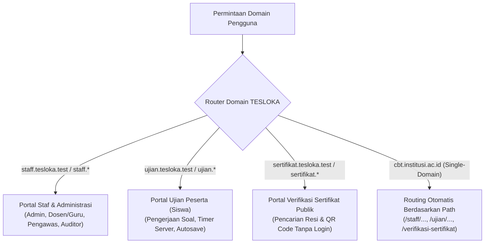

<p align="center">
  
</p>

<h1 align="center">TESLOKA CBT</h1>

<p align="center">
  <strong>Platform Sistem Evaluasi Computer-Based Test (CBT) Terstandar Institusi Pendidikan.</strong><br>
  Satu instalasi independen untuk satu institusi, 100% on-premise single-tenant dengan kedaulatan data penuh.
</p>

<p align="center">
  <a href="https://github.com/mdodeep/Tesloka"></a>
  
  
  
  
  
  
  
  
  
</p>

---

## Daftar Isi
- [Apa Itu TESLOKA?](#apa-itu-tesloka)
- [Arsitektur Tiga Portal Mandiri](#arsitektur-tiga-portal-mandiri)
- [16 Modul Utama Portal Staf & Administrasi](#16-modul-utama-portal-staf--administrasi)
- [Fitur Utama & Keunggulan Sistem](#fitur-utama--keunggulan-sistem)
- [Tutorial Operasional Lengkap Pasca-Deployment (Initial Setup to Daily Use)](#tutorial-operasional-lengkap-pasca-deployment-initial-setup-to-daily-use)
- [Integrasi Asesmen PTIQ English Proficiency Test (140 Butir)](#integrasi-asesmen-ptiq-english-proficiency-test-140-butir)
- [Standardisasi Antarmuka Modern & Multi-Device 12 Viewport](#standardisasi-antarmuka-modern--multi-device-12-viewport)
- [Matriks Sizing & Spesifikasi Server VPS](#matriks-sizing--spesifikasi-server-vps)
- [Panduan Instalasi Lingkungan Lokal (Development)](#panduan-instalasi-lingkungan-lokal-development)
- [Pemisahan Seeder: Produksi Bersih vs Simulasi Lokal](#pemisahan-seeder-produksi-bersih-vs-simulasi-lokal)
- [Akun Demo & Kredensial Bawaan Seeder](#akun-demo--kredensial-bawaan-seeder)
- [Panduan Deployment Produksi (Linux Ubuntu / aaPanel)](#panduan-deployment-produksi-linux-ubuntu--aapanel)
- [Panduan Pemecahan Masalah (Troubleshooting)](#panduan-pemecahan-masalah-troubleshooting)
- [Perintah CLI Artisan Bawaan](#perintah-cli-artisan-bawaan)
- [Automated Testing & Jaminan QA/QC](#automated-testing--jaminan-qaqc)
- [Struktur Direktori Proyek](#struktur-direktori-proyek)
- [Lisensi & Hak Cipta](#lisensi--hak-cipta)

---

## Apa Itu TESLOKA?

**TESLOKA** adalah platform Computer-Based Test (CBT) tingkat institusi berbasis Laravel 13 dan PostgreSQL 16+ ACID yang dirancang untuk dioperasikan secara mandiri di server milik institusi (*on-premise single-tenant*). Satu instalasi didedikasikan penuh untuk satu sekolah, madrasah, perguruan tinggi, ma'had aly, pondok pesantren, dinas pendidikan, atau lembaga sertifikasi kejuruan.

Aplikasi ini menolak ketergantungan pada model SaaS *multi-tenant* bersama untuk memastikan:
1. **Kedaulatan Data Penuh (Data Sovereignty):** Naskah bank soal rahasia, data pribadi siswa (NIK/NISN), rekaman pengawasan, dan riwayat nilai tidak pernah dikirimkan ke cloud pihak ketiga.
2. **PostgreSQL Sebagai Satu-Satunya Sumber Kebenaran (Single Source of Truth):** Seluruh jawaban peserta, lembar tanda terima submit (*digital receipt*), log heartbeat proctoring, dan riwayat revisi disimpan langsung secara transaksional ke PostgreSQL dengan penguncian baris (`SELECT ... FOR UPDATE`), bukan menggantungkan integritas pada LocalStorage atau RAM yang rentan hilang saat listrik padam.
3. **Ketahanan Jaringan Ekstrem (Zero Data Loss):** Algoritma *Monotonic Revision Sequence* mencegah request autosave lama menimpa revisi baru pada koneksi WiFi yang mengalami *jitter* atau *packet reordering*.

---

## Arsitektur Tiga Portal Mandiri

TESLOKA membagi antarmuka operasional menjadi tiga portal yang terisolasi secara komputasi dan hak akses:



### Opsi Konfigurasi Domain:
1. **Mode Multi-Subdomain (Rekomendasi Produksi Resmi):**
   - Portal Staf: `https://staff.institusi.ac.id/`
   - Portal Siswa: `https://ujian.institusi.ac.id/`
   - Portal Sertifikat Publik: `https://sertifikat.institusi.ac.id/`
2. **Mode Single-Domain (1 Alamat Domain Saja):**
   - Portal Staf: `https://cbt.institusi.ac.id/staff/login`
   - Portal Siswa: `https://cbt.institusi.ac.id/ujian/login`
   - Verifikasi Publik: `https://cbt.institusi.ac.id/verifikasi-sertifikat`
3. **Mode Offline LAN Laboratorium (Tanpa Sambungan Internet):**
   - Staf: `http://192.168.1.10/staff/login`
   - Siswa: `http://192.168.1.10/ujian/login`
   - Seluruh aset font Sora lokal, ikon Lucide, dan logo institusi termuat 100% lokal tanpa CDN eksternal.

---

## 16 Modul Utama Portal Staf & Administrasi

Portal Staf (`/staff`) mengintegrasikan 16 modul tata kelola komprehensif yang telah distandardisasi dengan komponen native Tailwind:

| No | Modul Staf | URL Rute | Deskripsi Fungsional & Kapabilitas |
|:---:|:---|:---|:---|
| **1** | **Dashboard Eksekutif** | `/staff/dashboard` | Statistik real-time, chart Apex area/bar aktivitas ujian, indikator server, dan ringkasan sesi aktif. |
| **2** | **Manajemen Pengguna** | `/staff/users` | Pengelolaan multi-peran (Admin, Guru, Pengawas, Siswa), impor Excel massal, reset password, dan bilah aksi massal (*bulk action*). |
| **3** | **Struktur Akademik** | `/staff/academic` | 5 tab data master: Tahun Ajaran, Semester, Jurusan, Kelas/Rombel, dan Mata Pelajaran beserta cetak kartu rombel massal. |
| **4** | **Bank Soal & Konten** | `/staff/question-banks` | Bank soal 7 format butir, stimulus wacana, rumus KaTeX, ekspor Word (.docx) OpenXML, dan impor multi-format (Aiken, GIFT, CSV, XLSX, Media Bundle ZIP). |
| **5** | **Perancangan Ujian** | `/staff/exams` | Konfigurasi paket ujian, cetak biru (*blueprint*), bobot, durasi, KKM, jadwal aktif, dan toggle mode simulasi (*try out*). |
| **6** | **Ruang Ujian** | `/staff/rooms` | Manajemen laboratorium komputer fisik, kapasitas kursi, denah nomor meja, dan status ketersediaan ruang. |
| **7** | **Sesi & Penjadwalan** | `/staff/sessions` | Penjadwalan sesi lab, rilis token dinamis, alokasi pengawas, serta pencetakan 7 dokumen legalitas sesi (A4). |
| **8** | **Penilaian & Koreksi** | `/staff/grading` | Rekapitulasi skor objektif otomatis, pusat koreksi esai berbasis kriteria rubrik dengan fitur *Blind Marking*, dan regrade massal. |
| **9** | **Hasil & Kelulusan** | `/staff/graduation` | Yudisium nilai, penetapan ambang KKM, penerbitan sertifikat digital berstempel resmi, dan Surat Keterangan Lulus (SKL). |
| **10** | **Grafik & Analitik** | `/staff/reports` | Analisis psikometri butir soal klasik: Tingkat Kesukaran ($P$), Daya Beda ($D$), matriks efektivitas distraktor (Upper/Lower 27%), dan Cronbach's Alpha / KR-20. |
| **11** | **Delegasi & Wewenang**| `/staff/delegations` | Manajemen pendelegasian mandat administratif sementara antar-staf dengan batas waktu (*expiry date*) dan audit trail. |
| **12** | **Four-Eyes Approval** | `/staff/approvals` | Mekanisme persetujuan ganda (*maker-checker*) untuk aksi kritis: penghapusan paket soal, ralat nilai kelulusan, dan restore basis data. |
| **13** | **Jejak Audit Sistem** | `/staff/security/audit-logs` | Pencatatan permanen (*immutable audit trail*) seluruh aktivitas operasional: alamat IP, user agent, event, perubahan data lama vs baru. |
| **14** | **Kesehatan Sistem** | `/staff/system/health` | Metrik kesehatan sistem: utilisasi CPU, memori RAM, koneksi PostgreSQL, latensi Redis, antrean queue worker, dan ruang disk. |
| **15** | **Cadangan & Arsip** | `/staff/backups` | Manajemen backup snapshot basis data PostgreSQL manual/otomatis, pengunduhan berkas `.sql.gz`, dan arsip data historis ujian. |
| **16** | **Integrasi API & Webhook** | `/staff/integrations` | Manajemen kunci API (*API Keys*), konfigurasi webhook event transaksi nilai, serta pengaturan Safe Exam Browser (SEB) & Browser Exam Key (BEK). |

> Dilengkapi pula modul pendukung: **Log Pengiriman Email** (`/staff/settings/notification-logs`), **Pustaka Media Stimulus** (`/staff/media`), **Pengaturan & Branding Institusi** (`/staff/settings/general`), **Konfigurasi SMTP** (`/staff/settings/smtp`), dan **Profil Staf Terpadu** (`/staff/profile`).

---

## Fitur Utama & Keunggulan Sistem

1. **7 Ragam Tipe Butir Soal Terstandar:**
   - Pilihan Ganda Tunggal (1 opsi benar dari A/B/C/D/E dengan penegasan mutual exclusive radio button)
   - Pilihan Ganda Kompleks (multi-jawaban benar dengan kotak centang dan skor parsial proporsional)
   - Benar / Salah (evaluasi premis pernyataan akademik dengan seleksi radio mutual exclusive)
   - Menjodohkan / Matching (menghubungkan pasangan premis kiri dan respons kanan)
   - Isian Singkat / Short Answer (pencocokan kata kunci toleran *case-insensitive*)
   - Esai Terstruktur Berbasis Rubrik (koreksi bertingkat dengan kriteria bobot dan opsi *Blind Marking*)
   - Skala Likert (survei afektif, kepribadian, dan evaluasi pengajaran 1–5)
2. **Editor Visual Quill Snow & Dual-Mode Switcher:**
   Penyusunan butir soal dilengkapi editor WYSIWYG Quill Snow modern dengan tombol alih mode instan: Mode Visual (format heading, bold, italic, underline, strike, sub/superskrip, lists, blok kode, blockquote, teks Arab RTL) dan Mode Teks Kode / Raw HTML dengan sinkronisasi dua arah real-time.
3. **Pusat Collapsible Panduan KaTeX & Palet 50+ Simbol 1-Klik:**
   Komponen collapsible tepat di bawah editor pokok soal yang menyediakan palet 50+ simbol cepat matematika ($\pm$, $\times$, $\div$, $\neq$, $\le$, $\ge$, $\sqrt{}$, $\infty$, $\sum$, $\int$), Yunani ($\alpha$, $\beta$, $\theta$, $\lambda$, $\pi$), dan sains ($^\circ\text{C}$, $\text{m/s}^2$, $\Omega$) dengan fitur 1-klik sisipkan langsung ke kursor aktif editor, serta tabel sintaks rumus KaTeX siap pakai.
4. **Pustaka Media Terisolasi & Audio Listening Stimulus:**
   Manajemen terpusat berkas audio listening MP3, diagram soal, dan wacana stimulus di `storage/app/private/media` dengan dukungan HTTP Range streaming (`Accept-Ranges: bytes`) untuk pemutaran audio lancar tanpa buffering. Pemutar audio native di layar siswa tanpa kebocoran naskah transkrip wacana.
5. **Timer Server-Side Absolut:**
   Sisa waktu ujian dihitung murni mengacu pada jam NTP server institusi. Memanipulasi jam di komputer siswa tidak berpengaruh pada waktu pengerjaan.
6. **Proteksi IDOR & Isolasi Sesi Perangkat:**
   Penegakan otorisasi tingkat server secara ketat. Siswa A dilarang keras mengakses pengerjaan milik siswa B (otomatis membalas `HTTP 403 Forbidden`). Satu akun siswa hanya dapat aktif di satu perangkat dalam satu waktu.
7. **Tanda Terima Digital Ber-Hash SHA-256:**
   Setiap penyerahan lembar ujian menghasilkan digital receipt unik ber-hash SHA-256 yang memuat stempel waktu detik, rincian butir terjawab, dan tanda tangan kriptografis anti-sengketa.
8. **Ekspor Word (.DOCX) OpenXML Murni & PDF Server-Side:**
   Pembuatan berkas Microsoft Word `.docx` asli tanpa library eksternal berat menggunakan `ZipArchive` bawaan PHP, serta perenderan dokumen cetak resmi PDF biner di server via `dompdf`.
9. **Portal Verifikasi Publik Berpagar KKM:**
   Publik dapat memverifikasi nomor resi kelulusan atau memindai QR Code sertifikat secara instan pada `https://sertifikat.tesloka.test/` dengan caching Redis ber-TTL 1 jam, di mana peserta yang belum lulus KKM secara tegas ditolak penerbitan sertifikatnya.
10. **Mode Ujian Daring Jarak Jauh (Online Remote):**
    Opsi perancangan ujian `delivery_mode: online` yang membebaskan institusi dari kewajiban alokasi ruang lab komputer fisik. Peserta dapat mengerjakan ujian dari rumah secara fleksibel dengan tetap terlindungi oleh heartbeat telemetri dan pengawasan webcam real-time.
11. **Mode Sertifikasi Bahasa / TOEFL / EPT Bebas KKM:**
    Pengaturan `is_certification: true` yang menonaktifkan konsep lulus/gagal KKM biner dan beralih ke evaluasi murni berdasarkan band score total capaian dan predikat kecakapan (*Elementary, Intermediate, Advanced*).
12. **WebRTC Live-Only Camera Proctoring & CCTV Zoom Grid (DEC-004):**
    Widget kamera Picture-in-Picture di antarmuka siswa yang secara otomatis menangkap snapshot saat mulai ujian, secara berkala setiap 45 detik, saat berpindah tab (*tab blur*), dan saat keluar layar penuh (*fullscreen exit*). Sisi pengawas dilengkapi **Modal Zoom CCTV** interaktif beresolusi tinggi, telemetri live, histori foto insiden, dan penangkapan snapshot instan on-demand.
13. **Master Data Akademik Ber-Retensi Tab & Enrolment Rombel:**
    Navigasi master akademik yang mempertahankan tab aktif saat submit data, filter jenjang program studi (S1, S2, D3), serta alur pendaftaran siswa ke rombongan belajar dengan fasilitas cetak kartu ujian rombel massal.

---

## Tutorial Operasional Lengkap Pasca-Deployment (Initial Setup to Daily Use)

Panduan operasional lengkap step-by-step telah didokumentasikan secara rinci pada:
> **Dokumentasi Lengkap:** [`docs/TUTORIAL-PENGGUNAAN-LENGKAP.md`](docs/TUTORIAL-PENGGUNAAN-LENGKAP.md)

### Ringkasan Alur Operasional 12 Langkah:
1. **Initial Setup Pasca-Deployment:**
   - Jalankan `php artisan tesloka:install` (atau kunjungi `https://staff.domainanda.sch.id/install` di browser).
   - Bila menginisialisasi manual tanpa wizard: jalankan `php artisan migrate --force`, `php artisan storage:link`, dan `php artisan db:seed --class=ProductionCleanDatabaseSeeder --force` (atur `TESLOKA_ADMIN_PASSWORD` di `.env` atau catat kata sandi acak yang dicetak command).
   - Login ke `https://staff.domainanda.sch.id/staff/login` menggunakan akun administrator yang telah dikonfigurasi.
2. **Branding & Konfigurasi Lembaga:**
   - Masuk ke menu `/staff/settings/general` untuk mengatur nama lembaga, alamat, NIP kepala lembaga, logo institusi, dan favicon.
   - Masuk ke `/staff/settings/smtp` untuk konfigurasi server email notifikasi transaksional.
3. **Penyusunan Master Data Akademik Terstruktur:**
   - Masuk ke menu `/staff/academic` dan isi data berurutan: Tahun Ajaran -> Semester -> Jurusan & Dept -> Kelas & Rombel -> Mata Pelajaran.
4. **Pendaftaran Pengguna & Enrolment Rombel:**
   - Masuk ke `/staff/users` untuk membuat akun Guru dan Pengawas.
   - Impor massal data siswa via berkas template Excel/CSV.
   - Daftarkan siswa ke rombongan belajar di `/staff/academic?tab=classes` untuk pencetakan kartu kelas massal.
5. **Penyusunan Bank Soal & Stimulus Media:**
   - Masuk ke `/staff/question-banks` untuk membuat bank soal dari 7 tipe soal terstandar.
   - Manfaatkan Quill Snow WYSIWYG, palet rumus KaTeX, dan unggah audio MP3 stimulus listening.
   - Atau gunakan CLI mandiri: `php artisan tesloka:import-questions berkas.zip`.
6. **Perancangan Ujian (Exam Creation):**
   - Masuk ke `/staff/exams` dan pilih mode pelaksanaan (Daring vs Onsite) serta mode penilaian (Sertifikasi Bebas KKM vs Reguler).
   - Bentuk paket soal, kunci paket (*immutable snapshot*), dan terbitkan ujian.
7. **Penjadwalan Sesi & Rilis Token:**
   - Masuk ke `/staff/sessions` untuk membuat sesi, mendaftarkan peserta, mencetak 7 dokumen legalitas A4 (Kartu, Tempelan Meja, Daftar Hadir, Berita Acara), dan merilis token ujian.
8. **Pelaksanaan Ujian Peserta (Student CBT):**
   - Siswa login di `https://ujian.institusi.ac.id/`, memverifikasi webcam, memasukkan token sesi, dan mengerjakan soal.
   - Dilindungi oleh sinkronisasi timer NTP absolut, autosave transaksional ber-sequence, dan layout mobile responsif.
9. **Pengawasan Real-Time & CCTV Zoom Grid:**
   - Pengawas memantau kemajuan pengerjaan siswa di `/staff/sessions/{id}/monitor` dan `/staff/sessions/{id}/camera-grid`.
   - Menggunakan fitur Zoom CCTV untuk inspeksi visual siswa, cek riwayat insiden, dan tombol ambil snapshot seketika.
10. **Koreksi & Analisis Psikometri:**
    - Soal objektif dinilai otomatis; soal esai dikoreksi di `/staff/grading` dengan fitur *Blind Marking*.
    - Buka tab Analitik untuk evaluasi daya beda butir ($D$), tingkat kesukaran ($P$), dan efektivitas distraktor.
11. **Yudisium & Penerbitan Sertifikat:**
    - Kunci hasil nilai di `/staff/graduation`, terbitkan SKL dan Sertifikat Kelulusan resmi A4.
12. **Verifikasi Publik Kriptografis & Backup:**
    - Masyarakat umum memvalidasi keaslian dokumen di `https://sertifikat.institusi.ac.id/` via nomor resi atau scan QR Code.
    - Lakukan pencadangan basis data berkala di `/staff/backups`.

---

## Integrasi Asesmen PTIQ English Proficiency Test (140 Butir)

Aplikasi telah dilengkapi secara bawaan dengan paket asesmen berspesifikasi TOEFL ITP® Level 1 Style berkonteks studi keislaman Universitas PTIQ Jakarta pada direktori [`Soal/`](Soal/):

- **Section 1: Listening Comprehension (50 Soal):** Terbagi menjadi Part A (30 percakapan pendek), Part B (2 percakapan panjang akademik), dan Part C (3 ceramah kuliah filologi Al-Qur'an).
- **Section 2: Structure & Written Expression (40 Soal):** 15 butir Structure dan 25 butir Written Expression dengan format deteksi kesalahan kata bergaris bawah `(A)`, `(B)`, `(C)`, `(D)`.
- **Section 3: Reading Comprehension (50 Soal):** 5 teks wacana akademik (Reading Manuscripts as Evidence, Qira'at Variation, Tafsir Scholarship, Coherence in Qur'anic Discourse, dan Digital Tools in Research).

### Pilihan Format Impor Siap Pakai di Folder `Soal/`:
1. **Master Excel (.xlsx):** [`Soal/PTIQ_EPT_Paket_A_Lengkap_140_Soal.xlsx`](Soal/PTIQ_EPT_Paket_A_Lengkap_140_Soal.xlsx) (140 soal lengkap) dan berkas per-seksi.
2. **Media Bundle Archive ZIP:** [`Soal/PTIQ_EPT_Paket_A_Media_Bundle.zip`](Soal/PTIQ_EPT_Paket_A_Media_Bundle.zip) memuat `manifest.json`, 10 wacana stimulus lengkap, opsi jawaban, dan kunci resmi.
3. **Format Standar Internasional:** Format Aiken (`.aiken.txt`), Moodle GIFT (`.gift.txt`), dan CSV UTF-8 BOM.
4. **Dokumentasi & Master Kunci Jawaban:** [`Soal/PANDUAN-DAN-KUNCI-JAWABAN.md`](Soal/PANDUAN-DAN-KUNCI-JAWABAN.md) (cetak biru tes, tabel kunci jawaban 1–140, dan transkrip audio lengkap).

---

## Standardisasi Antarmuka Modern & Multi-Device 12 Viewport

Seluruh tampilan antarmuka dibangun di atas fondasi desain sistem modern Tailwind CSS dengan penyesuaian khusus CBT:

1. **Standar Baku Tabel Data (Native Modern - Zero Third-Party Bloat):**
   - Menghindari library bloated seperti Grid.js atau DataTables lama demi kecepatan render maksimal dan nol konflik DOM JavaScript.
   - Seluruh tabel dibungkus container responsif `<div class="overflow-x-auto -mx-3.5 sm:mx-0">`.
   - Diberikan batas lebar minimum eksplisit (`min-w-[700px]` s.d. `min-w-[850px]`) agar kolom tidak gepeng di layar ponsel.
   - Seluruh header `<th>` dan data `<td>` menggunakan kelas `whitespace-nowrap`.
   - Bilah aksi massal (*bulk action bar*) menggunakan layout `inline-flex` rapi dengan tombol "Hapus Terpilih" satu baris.
2. **Standar Baku Dialog Modal (Anti-Clipping & Scrollable):**
   - Struktur `max-h-[90vh] flex flex-col` dengan container isi `overflow-y-auto`.
   - Tombol aksi footer responsif: bertumpuk vertikal di layar ponsel (`flex flex-col-reverse sm:flex-row`).
3. **Palet Navigasi Soal Layar Ponsel:**
   - Palet daftar nomor soal pada layar ujian siswa berubah otomatis menjadi modal drawer popup di tengah layar (`fixed inset-0 lg:static z-50 bg-black/40 backdrop-blur-xs flex items-center justify-center`) agar siswa dapat melompat antar-nomor soal tanpa scroll panjang.
4. **13 Template Dokumen Cetak A4 Fisik (Normalisasi Box-Sizing):**
   - Container `.doc-viewport-container` menerapkan `box-sizing: border-box` universal untuk mengeliminasi 100% horizontal overflow di layar tablet dan desktop.
   - Presisi fisik A4 tanpa margin peramban bawaan (`print-color-adjust: exact`).
5. **Audit 12 Resolusi Multi-Device (300 Runs - 100% PASS - 0 Overflow, 0 Console Error):**
   - Diuji otomatis pada 25 halaman utama dari ketiga portal (`staff`, `ujian`, `sertifikat`) melintasi 12 viewport standar (300 uji browser: 300 PASS, 0 Anomali).
   - Resolusi Mobile: 320×568 (iPhone SE), 360×640 (Android), 375×667 (iPhone 8), 390×844 (iPhone 14), 414×896 (iPhone XR), 430×932 (iPhone 15 Pro Max).
   - Resolusi Tablet: 768×1024 (iPad Portrait), 1024×768 (iPad Landscape).
   - Resolusi Laptop / Desktop: 1280×720 (HD), 1366×768 (WXGA), 1440×900 (MacBook), 1920×1080 (FHD).
   - Header pengerjaan ujian siswa (`resources/views/student/exam/show.blade.php`) telah direfaktor dengan flex-shrink protection (`min-w-0 flex-1`) dan padding responsif sehingga `clientWidth === scrollWidth` (0 overflow) pada layar mobile $\le$ 430px.

---

## Matriks Sizing & Spesifikasi Server VPS

TESLOKA dapat beroperasi mulai dari VPS 1 vCPU 2 GB RAM hingga server fisik multi-core 32 GB RAM. Sesuaikan tuning memori PostgreSQL, PHP-FPM, dan Redis agar respon tetap di bawah 100 ms:

| Tier & Spesifikasi Server | Kapasitas Peserta Serentak | Rekomendasi Swap | PHP `memory_limit` | PHP-FPM `pm.max_children` | PostgreSQL `shared_buffers` | Redis `maxmemory` | Worker Queue |
|:---|:---|:---|:---|:---|:---|:---|:---|
| **Tier 1: 1 vCPU, 2 GB RAM** | 30 – 50 siswa (1 Lab Kecil) | `2 GB` | `256M` | `12` | `256MB` | `256mb` | 1 worker |
| **Tier 2: 2-4 vCPU, 4 GB RAM**| 50 – 150 siswa (Standar Sekolah) | `2 GB` | `256M` | `24` | `1GB` | `512mb` | 2 worker |
| **Tier 3: 4 vCPU, 8 GB RAM** | 150 – 300 siswa (Multi-Lab Kampus) | `4 GB` | `512M` | `48` | `2GB` | `1024mb` (1 GB) | 4 worker |
| **Tier 4: 4-8 vCPU, 16 GB RAM**<br>*(Baseline Produksi Resmi)*| **300 – 600 siswa (Enterprise Institusi)** | `4 GB` | `512M` | `64` | `4GB` | `2048mb` (2 GB) | 6 worker |
| **Tier 5: 8-16 vCPU, 32 GB RAM**| 600 – 1.200+ siswa (Ujian Akbar) | `8 GB` | `1024M` | `128` | `8GB` | `4096mb` (4 GB) | 8 worker |

> [!NOTE]
> **Spesifikasi VPS Produksi Acuan Resmi:** 4 vCPU, 16 GB RAM, 100 GB SSD Enterprise RAID 10, Dedicated IPv4, Data Center Jakarta.

---

## Panduan Instalasi Lingkungan Lokal (Development)

Lingkungan pengembangan yang direkomendasikan adalah **Windows dengan Laragon**, atau Linux / macOS dengan stack PHP 8.3–8.5, PostgreSQL 16+, dan Redis 7+.

### 1. Clone Repositori
```bash
git clone https://github.com/mdodeep/Tesloka.git
cd Tesloka
```

### 2. Pasang Dependensi PHP & Node.js
```bash
composer install
npm install
```

### 3. Konfigurasi Lingkungan (`.env`)
Salin file `.env.example` ke `.env` lalu generate application key:
```bash
cp .env.example .env
php artisan key:generate
```

Sesuaikan parameter basis data PostgreSQL dan Redis di `.env`:
```ini
APP_NAME=TESLOKA
APP_ENV=local
APP_DEBUG=true
APP_URL=https://cbt.tesloka.test

DB_CONNECTION=pgsql
DB_HOST=127.0.0.1
DB_PORT=5432
DB_DATABASE=tesloka
DB_USERNAME=postgres
DB_PASSWORD=password_lokal_anda

CACHE_STORE=redis
QUEUE_CONNECTION=redis
SESSION_DRIVER=redis

REDIS_CLIENT=phpredis
REDIS_HOST=127.0.0.1
REDIS_PORT=6379
```

### 4. Eksekusi Migrasi & Seeder Simulasi
Buat database bernama `tesloka` di PostgreSQL, lalu jalankan:
```bash
php artisan migrate --seed
```

### 5. Hubungkan Berkas Simpanan Publik (Storage Link)
```bash
php artisan storage:link
```

### 6. Kompilasi Aset Frontend
```bash
# Mode pengembangan (HMR):
npm run dev

# Mode build produksi bersih:
npm run build
```

### 7. Virtual Host Lokal (Laragon / Apache / Nginx)
Tambahkan virtual host lokal yang mengarah ke direktori `public/`:
- `https://staff.tesloka.test`
- `https://ujian.tesloka.test`
- `https://sertifikat.tesloka.test`

---

## Pemisahan Seeder: Produksi Bersih vs Simulasi Lokal

Sistem menerapkan arsitektur pemisahan seeder yang ketat untuk menjaga keamanan dan kebersihan data:

1. **Seeder Khusus Lingkungan Produksi (`ProductionSeeder.php`):**
   - Dijalankan saat `APP_ENV=production` atau `php artisan db:seed --class=ProductionSeeder`.
   - **HANYA** memuat profil dasar institusi (`InstitutionSeeder`), matriks RBAC 14 roles (`RolePermissionSeeder`), template notifikasi standar (`NotificationTemplateSeeder`), dan **TEPAT SATU** akun Administrator Utama (`admin`).
   - Database bersih 100% dari data dummy. Tabel siswa, rombel, bank soal, dan rekaman ujian dipastikan kosong (`0 records`).
2. **Seeder Khusus Lingkungan Lokal / Development (`RealisticExamSimulationSeeder.php`):**
   - Dijalankan saat `APP_ENV=local` via `php artisan db:seed`.
   - Memuat ekosistem CBT nyata: 2 ruang lab komputer, 12 siswa aktif ber-NIK/NIM, struktur akademik lengkap, bank soal komprehensif, perancangan ujian aktif, rekaman ujian tersubmit (Fatimah lulus, Ali remedial), sesi ujian aktif pengerjaan (Siswa01 in progress), dan paket 140 soal PTIQ English Proficiency Test.

---

## Akun Demo & Kredensial Bawaan Seeder

Setelah menjalankan `php artisan migrate --seed` pada lingkungan lokal, seluruh akun demo berikut siap digunakan:

> **Kata Sandi Universal Seluruh Akun Demo Seeder:** `Tesloka2026!`

| Peran | Username | Portal Akses | Skenario Pengujian |
|:---|:---|:---|:---|
| **Administrator Utama** | `admin` | `staff.tesloka.test` | Akses penuh ke-16 modul staf, backup database, branding, audit logs. |
| **Dosen / Guru Pengampu**| `ahmad_guru` | `staff.tesloka.test` | Bank soal PTIQ 140 butir, blueprint ujian, koreksi esai rubrik, psikometri. |
| **Pengawas Ruangan** | `pengawas1` | `staff.tesloka.test` | Bilah kendali proctoring real-time, rilis token sesi, reset sesi perangkat. |
| **Siswa Lulus (Sertifikat)**| `fatimah_peserta` | `ujian.tesloka.test` | Ujian tersubmit, skor 92.50, tanda terima `RCP-FWUL-WQII-R0ZH` sah verifikasi. |
| **Siswa Remedial (KKM)** | `ali_peserta` | `ujian.tesloka.test` | Ujian tersubmit, skor 65.00, tanda terima `RCP-NU6Z-B7JT-O1OO` remedial. |
| **Siswa Pengerjaan Aktif**| `siswa01` | `ujian.tesloka.test` | Pengerjaan aktif (*in progress*), timer 75 menit, autosave transaksional. |
| **Siswa Rombel 02 s.d. 10**| `siswa02` s.d. `siswa10` | `ujian.tesloka.test` | Rombongan belajar kelas TIQ-1A untuk simulasi ujian serentak. |

---

## Metode Pemasangan & Installer Resmi (Web Wizard & VPS Auto-Installer)

TESLOKA CBT menyediakan **tiga metode installer resmi terpadu** yang dirancang agar instalasi di server produksi maupun lokal dapat diselesaikan dalam hitungan menit:

### 1. One-Line Auto-Installer Script untuk VPS Linux (aaPanel & Fresh VPS)
Untuk server VPS Linux (Ubuntu 20.04/22.04/24.04, Debian 11/12, AlmaLinux/Rocky 9) maupun server yang menjalankan **aaPanel**:
```bash
sudo bash deploy/install.sh
# Atau langsung eksekusi dari repository:
curl -fsSL https://raw.githubusercontent.com/mdodeep/Tesloka/main/deploy/install.sh | sudo bash
```
> [!NOTE]
> Skrip ini secara otomatis mendeteksi lingkungan aaPanel atau fresh VPS, mengonfigurasi Nginx, PHP 8.4/8.5, PostgreSQL 16, Redis, Supervisor queue worker, task scheduler cron, dan mencetak laporan kredensial akses komprehensif di akhir proses.

### 2. Web Setup Wizard Berbasis Browser (`/install`)
Bagi administrator yang menggunakan server yang sudah terpasang web server (cPanel, aaPanel, Laragon, atau LAMP/LEMP stack):
1. Buka peramban dan akses alamat portal staf: `https://staff.domainanda.sch.id/install`.
2. Sistem otomatis memandu melalui 6 langkah grafis:
   - **Prasyarat Server:** Validasi otomatis versi PHP, ekstensi wajib, dan izin baca-tulis storage.
   - **Basis Data & Cache:** Konfigurasi host, port, user, password PostgreSQL & Redis dengan tombol live Ajax connection test.
   - **Identitas Institusi:** Pengaturan nama resmi sekolah/kampus, NPSN, dan pemetaan tiga URL portal.
   - **Akun Administrator:** Pembuatan kredensial Super Administrator utama.
   - **Eksekusi Otomatis:** Menjalankan migrasi database, seeding profil produksi, dan pembuatan storage symlink.
   - **Selesai & Terkunci:** Menampilkan ringkasan akses lengkap, tombol unduh kredensial `.txt`, serta penguncian permanen berkas `storage/installed.lock`.

### 3. CLI Command Installer
Untuk teknisi yang menyukai pemasangan melalui terminal tanpa browser:
```bash
php artisan tesloka:install
# Atau mode otomatis non-interaktif:
php artisan tesloka:install --non-interactive --db-name=tesloka --db-user=postgres --admin-email=admin@sekolah.sch.id
```

---

## Panduan Deployment Produksi (Linux Ubuntu / aaPanel)

Panduan instalasi langkah-demi-langkah lengkap untuk server Linux Ubuntu dan panel aaPanel tersedia pada:
[deploy/INSTALL-AAPANEL.md](deploy/INSTALL-AAPANEL.md)

### Ringkasan Langkah Cepat Produksi:
1. **Persiapan OS Linux & Swap File 2–4 GB:**
   ```bash
   sudo apt update && sudo apt upgrade -y
   sudo apt install -y curl wget git unzip htop build-essential supervisor
   sudo fallocate -l 4G /swapfile && sudo chmod 600 /swapfile
   sudo mkswap /swapfile && sudo swapon /swapfile
   echo '/swapfile none swap sw 0 0' | sudo tee -a /etc/fstab
   sudo timedatectl set-timezone Asia/Jakarta
   ```
2. **Pasang Paket Stack di App Store aaPanel:**
   - Nginx (1.24 atau 1.26+)
   - PHP (PHP 8.3 / 8.4 / 8.5) beserta ekstensi: `pdo_pgsql`, `pgsql`, `redis`, `opcache`, `fileinfo`, `exif`, `gd`, `zip`, `bcmath`.
   - PostgreSQL (v16 atau 17) & Redis (v7 atau 8).
   - Node.js LTS v20.
3. **Inisialisasi Proyek di `/www/wwwroot/cbt.institusi.ac.id`:**
   ```bash
   cd /www/wwwroot/cbt.institusi.ac.id
   git clone https://github.com/mdodeep/Tesloka.git .
   cp .env.example .env
   # Edit .env dengan APP_ENV=production, kredensial DB PostgreSQL, & Redis
   composer install --no-dev --optimize-autoloader
   npm install && npm run build
   php artisan key:generate --force
   php artisan migrate --force
   php artisan db:seed --class=ProductionCleanDatabaseSeeder --force
   php artisan storage:link
   chown -R www:www /www/wwwroot/cbt.institusi.ac.id
   chmod -R 775 storage bootstrap/cache
   php artisan optimize
   ```
4. **Konfigurasi Site Directory & URL Rewrite (PENTING ANTI-404):**
   - Tab **Site Directory**: Ubah **Running directory** dari `/` menjadi `/public` lalu simpan.
   - Tab **URL rewrite**: Pilih preset **laravel 5** (`try_files $uri $uri/ /index.php?$query_string;`) lalu simpan.
5. **Supervisor Background Worker & Scheduler:**
   - Buat file konfigurasi Supervisor di `/etc/supervisor/conf.d/tesloka-worker.conf`:
     ```ini
     [program:tesloka-worker]
     process_name=%(program_name)s_%(process_num)02d
     command=php /www/wwwroot/cbt.institusi.ac.id/artisan queue:work redis --sleep=3 --tries=3 --max-time=3600 --timeout=120
     autostart=true
     autorestart=true
     user=www
     numprocs=4
     redirect_stderr=true
     stdout_logfile=/www/wwwroot/cbt.institusi.ac.id/storage/logs/worker.log
     ```
   - Tambahkan Cron tiap 1 menit untuk scheduler:
     ```bash
     * * * * * cd /www/wwwroot/cbt.institusi.ac.id && php artisan schedule:run >> /dev/null 2>&1
     ```

---

## Panduan Pemecahan Masalah (Troubleshooting)

### 1. Error 404 Not Found Saat Mengakses Rute / Login
- **Penyebab:** Running directory Nginx belum mengarah ke `/public` atau URL Rewrite belum aktif.
- **Solusi:** Di aaPanel Website Settings, pastikan **Running Directory** = `/public` dan tab **URL Rewrite** menerapkan preset `laravel 5`.

### 2. Error 502 Bad Gateway
- **Penyebab:** Layanan PHP-FPM tidak berjalan atau salah menunjuk socket path (`/tmp/php-cgi-85.sock` vs `/run/php/php8.5-fpm.sock`).
- **Solusi:** Cek status `systemctl status php8.5-fpm` dan pastikan konfigurasi `fastcgi_pass` Nginx sesuai dengan file socket yang aktif.

### 3. Error 500 Internal Server Error & Blank White Screen
- **Penyebab:** Izin folder `storage/` belum diberikan ke user web server (`www`), `APP_KEY` belum terpasang, atau cache usang.
- **Solusi:**
  ```bash
  php artisan key:generate --force
  chown -R www:www storage bootstrap/cache
  chmod -R 775 storage bootstrap/cache
  php artisan optimize:clear
  ```

### 4. Database Connection Refused / Ident Authentication Failed
- **Penyebab:** Konfigurasi host database di `.env` masih `localhost` atau PostgreSQL menolak autentikasi kata sandi.
- **Solusi:** Ubah `DB_HOST=127.0.0.1` di `.env`, dan pastikan `/etc/postgresql/16/main/pg_hba.conf` mengizinkan metode `scram-sha-256` untuk `127.0.0.1/32`.

### 5. Redis Error OOM (Out Of Memory)
- **Penyebab:** Memori Redis penuh dan policy disetel ke `noeviction`.
- **Solusi:** Buka `redis.conf`, atur `maxmemory-policy allkeys-lru` agar Redis mendaur ulang cache lama otomatis, lalu restart Redis.

### 6. Error `exec()` atau `symlink()` Nonaktif Saat Web Installer (aaPanel)
- **Penyebab:** Panel hosting seperti aaPanel menonaktifkan fungsi `symlink` dan `exec` pada daftar `disable_functions` PHP secara bawaan.
- **Solusi:** Installer TESLOKA menangani kondisi ini secara aman tanpa gagal dan menampilkan perintah manual `ln -s`. Untuk pembuatan symlink otomatis penuh tanpa membuka `exec()`, hapus hanya `symlink` dari daftar `disable_functions` PHP di aaPanel (biarkan `exec` tetap nonaktif untuk keamanan).

---

## Perintah CLI Artisan Bawaan

```bash
# 1. Pemasang Sistem Headless CLI (Interaktif atau Non-Interaktif):
php artisan tesloka:install
php artisan tesloka:install --non-interactive --db-name=tesloka --db-user=postgres --admin-email=admin@institusi.ac.id

# 2. Impor Paket Soal Cepat Mandiri (Format ZIP Media Bundle / XLSX):
php artisan tesloka:import-questions storage/app/PTIQ_EPT_Paket_A_Media_Bundle.zip --bank="QB-EPT-A" --subject="ENG-01"

# 3. Uji Kesiapan Produksi (Memeriksa 8 Indikator Kritis Sistem):
php artisan tesloka:production-check

# 4. Menjalankan Seluruh Automated Test Suite (352 Tests, PHPUnit):
php artisan test

# 5. Simulasi Beban Pengerjaan & Autosave Bersamaan:
php artisan tesloka:simulate-load --students=50 --answers=10

# 6. Membersihkan Seluruh Cache Laravel:
php artisan optimize:clear

# 7. Menjalankan Antrean Queue Worker secara Manual:
php artisan queue:work redis --tries=3

# 8. Pipeline Rilis & Obfuskasi Publik Otomatis (PowerShell):
powershell -ExecutionPolicy Bypass -File .\scripts\sync-obfuscated-release.ps1
```

---

## Automated Testing & Jaminan QA/QC

Sistem TESLOKA dibangun dengan standar pengujian mutlak berbasis bukti eksekusi (*evidence-based quality assurance*):

- **Backend Automated Test Suite:** Seluruh unit & feature test suite terverifikasi **100% PASS** pada PostgreSQL (`docs/HASIL-PENGUJIAN.md`).
- **Headless Browser Multi-Device Testing:** Pengujian interaksi peramban (Puppeteer / Chrome Headless) lintas portal (`staff`, `ujian`, `sertifikat`, dan `tesloka-donate`) pada viewport mobile, tablet, hingga desktop menghasilkan 0 error konsol dan 0 horizontal overflow.
- **Code Style Linting:** 100% lulus standar PSR-12 via Laravel Pint (`vendor/bin/pint --test`).
- **Frontend Asset Compilation:** Seluruh modul aset frontend terkompilasi bersih via Vite.
- **Protokol Zero-Input & Pipeline Rilis Obfuskasi:** Sinkronisasi satu arah otomatis ke repositori publik terdistribusi (`D:\laragon\www\tesloka-obfuscated`) dengan obfuskasi kode PHP bisnis layer (controllers, services, jobs, middleware), 0 syntax error, dan commit otomatis.

Dokumentasi lengkap hasil pengujian dan matriks keterlacakan fitur tersedia di:
- [docs/HASIL-PENGUJIAN.md](docs/HASIL-PENGUJIAN.md)
- [docs/PROGRESS.md](docs/PROGRESS.md)

---

## Struktur Direktori Proyek

```
tesloka/
├── app/
│   ├── Http/Controllers/     # 41 Controller (Staff, Student, Public, Media, API)
│   ├── Http/Middleware/      # Pemisahan Portal, Safe Exam Browser, RBAC, Profil, Security
│   ├── Jobs/                 # Queue background jobs (ekspor, regrade, email)
│   ├── Models/               # 51 Model Eloquent & Relasi Database
│   └── Services/             # Logika bisnis (psikometri, grading, integrasi SEB, sanitasi)
├── database/
│   ├── migrations/           # 30 Berkas migrasi skema tabel PostgreSQL
│   └── seeders/              # Seeder produksi (bersih) & seeder simulasi lokal
├── deploy/                   # Konfigurasi deployment produksi siap pakai
│   ├── nginx/                # Template virtual host Nginx (HTTP & HTTPS)
│   ├── php-fpm/              # Konfigurasi pool PHP-FPM & sizing table
│   ├── redis/                # Konfigurasi memory & LRU policy Redis
│   ├── supervisor/           # Konfigurasi daemon worker & scheduler
│   ├── livekit/              # Docker compose server kamera proctoring
│   └── INSTALL-AAPANEL.md    # Panduan resmi instalasi produksi lengkap
├── docs/                     # Dokumentasi teknis, arsitektur, & register pengujian
├── Landing/                  # Website publik, demo sandbox, & dokumentasi teknis
├── public/
│   ├── assets/fonts/         # Font lokal Sora resmi (bebas CDN eksternal)
│   ├── assets/images/        # Logo institusi resmi, favicon WebP, avatar
│   └── build/                # Aset frontend Vite terkompilasi
├── resources/
│   ├── css/                  # Stylesheet tema antarmuka & Tailwind CSS 4
│   ├── js/                   # Skrip interaktif, timer, autosave handler
│   └── views/                # 103 Template Blade (staff, student, public, errors)
├── routes/
│   ├── staff.php             # Rute 16 modul staf & administrasi
│   ├── student.php           # Rute portal ujian peserta
│   ├── api.php               # API endpoint transaksional (autosave, heartbeat)
│   └── web.php               # Router domain & portal verifikasi sertifikat publik
├── Soal/                     # Berkas asesmen siap upload PTIQ EPT 140 butir (XLSX, ZIP, Aiken, GIFT)
└── tests/                    # 49 Berkas pengujian fitur, keamanan & unit (PHPUnit)
```

---

## Lisensi & Hak Cipta

Hak Cipta &copy; 2026 **TESLOKA**, dikembangkan oleh **Muhammad Dody Pratama** ([@mdodeep](https://github.com/mdodeep)). Seluruh hak cipta dilindungi undang-undang.

Dilisensikan secara tertutup (*proprietary on-premise single-tenant*) untuk institusi pendidikan pengguna berlisensi resmi.
